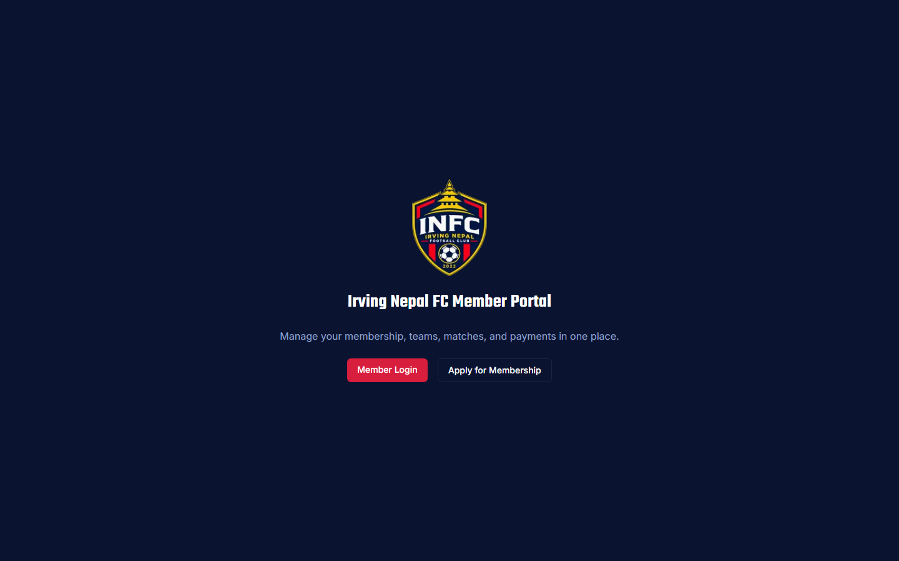
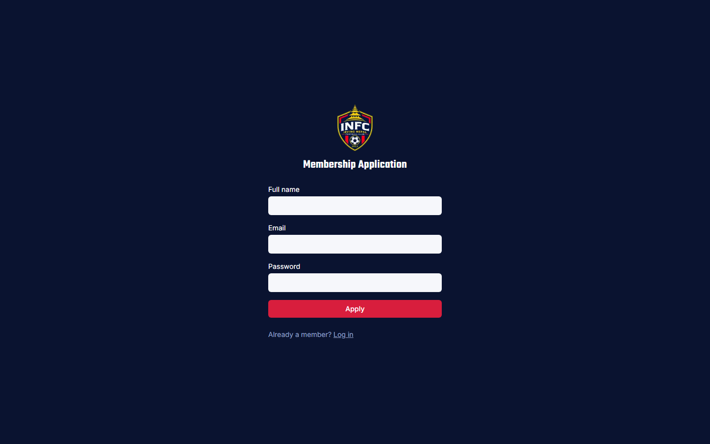
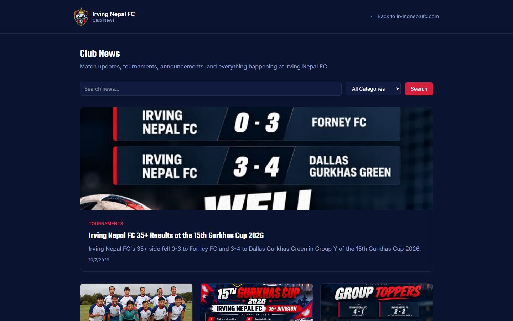
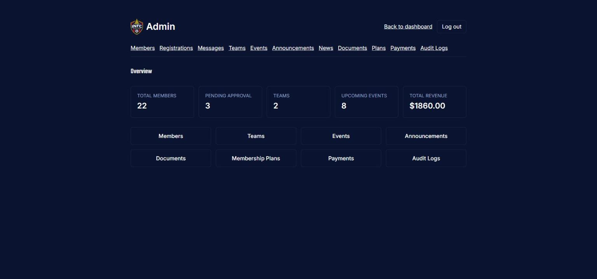
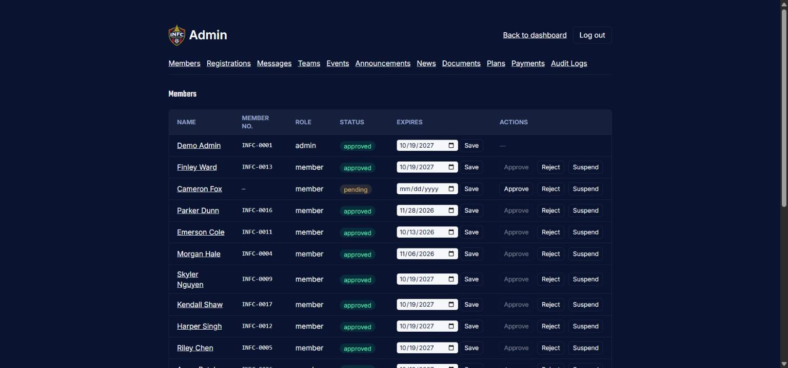
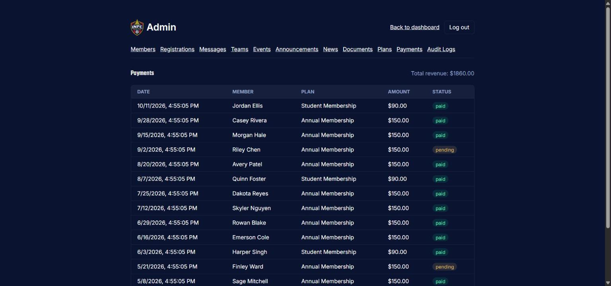
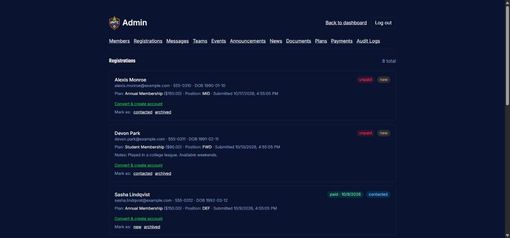
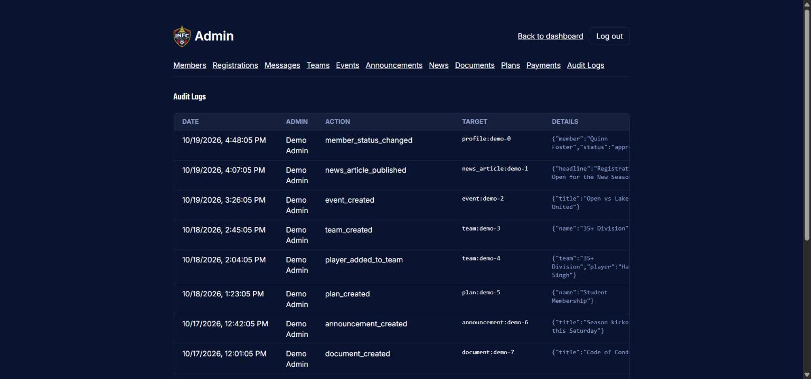

# Irving Nepal FC — Club Platform

Member portal, payments, and newsroom for [Irving Nepal FC](https://irvingnepalfc.com), a community soccer club in Irving, Texas. Built and maintained by [Rakesh KC](https://github.com/Rakesh-KC-Tech).

**Member portal:** [portal.irvingnepalfc.com](https://portal.irvingnepalfc.com) · **Club website:** [irvingnepalfc.com](https://irvingnepalfc.com)

## What it does

- **Member accounts** with approval-based sign-up (pending → approved / rejected / suspended) and role-based access (member / admin).
- **Registrations and payments** through Stripe: membership plans, checkout, signature-verified webhooks, and automatically generated invoices.
- **Admin dashboard** for members, teams, events, documents, announcements, registrations, payments, messages, and an audit log of admin actions.
- **Teams and events** with RSVPs, attendance, and player stats.
- **Club news** with an AI-assisted drafting pipeline: new YouTube uploads and match results become article drafts (plus generated match graphics) for a human to review before publishing.
- **Live match data** from the ClubVerse Partner API, exposed to the public marketing site through small JSON endpoints.
- **Contact form and newsletter**, with email notifications.

## Screenshots

Public pages come from the live portal. The member area and admin dashboard sit behind login and hold real member and payment data, so the admin screens further down were captured from a local copy running against a throwaway database filled with fictional demo data.

| Landing page | Membership application |
| --- | --- |
|  |  |

**Club news.** Match-result graphics like the one below are generated automatically from live match data, and articles are drafted for human review before publishing.



### Admin dashboard (demo data)

All names, emails, and payments below are fictional.

**Overview** with live counts for members, pending approvals, teams, upcoming events, and revenue.



**Members**: approve, reject, or suspend applicants and set membership expiry.



**Payments**: Stripe-backed payment history with status and total revenue.



**Registrations**: public sign-ups with payment status, ready to convert into member accounts.



**Audit log**: every admin action is recorded with who did it, what changed, and when.



## Stack

| Layer | Tech |
| --- | --- |
| Framework | Next.js 16 (App Router), React 19, TypeScript |
| Styling | Tailwind CSS 4 |
| Database and auth | Supabase (PostgreSQL, Auth, Row Level Security) |
| Payments | Stripe |
| AI | Anthropic Claude API (article drafting) |
| Hosting | Vercel, including a daily cron job for news sync |

## Security design

- **Row Level Security** is enabled on the database tables: 38 policies across 15 migrations in [`supabase/migrations`](supabase/migrations), so access rules live in the database, not only in app code.
- Session refresh and route protection in middleware for `/dashboard` and `/admin`.
- The Supabase **service-role key is server-only**. It is used where no signed-in user exists, such as the Stripe webhook.
- Stripe webhooks are verified with the signing secret; the cron endpoint requires a bearer secret.
- Admin actions are written to an audit log.
- Secrets are never committed: `.env*` is git-ignored, and only [`.env.local.example`](.env.local.example) (names, no values) is tracked.

## Project layout

```
src/app/          Routes: public pages, member area, /admin, and /api endpoints
src/lib/          Supabase clients, Stripe, ClubVerse client, news ingestion
supabase/migrations/   Versioned SQL schema and RLS policies
scripts/          Match-graphic generation
```

## Run it locally

```bash
npm install
cp .env.local.example .env.local   # fill in your own values
npm run dev
```

Open [http://localhost:3000](http://localhost:3000). You will need your own Supabase project (apply the SQL files in `supabase/migrations` in order) and Stripe test-mode keys. The Anthropic, YouTube, ClubVerse, and Resend keys are only needed for the features that use them.

To make your first admin, sign up through `/signup`, then run in the Supabase SQL editor:

```sql
update public.profiles set role = 'admin', status = 'approved'
where id = '<your-auth-user-id>';
```

## Deploy

Deployed on Vercel. Add the same environment variables from `.env.local` in the project settings, set `NEXT_PUBLIC_SITE_URL` to the production URL, and point your Stripe webhook at `/api/webhooks/stripe`.
